# Bowl Builder


A full-stack custom bowl ordering app. Customers build a bowl with a live price and nutrition panel and place an order. Kitchen staff see orders arrive in real time and move them through a strict status flow.

**Live demo:** https://bowl-builder-frontend.vercel.app

> The backend runs on a free tier, so the very first load after a long idle period can take a minute while it wakes up.

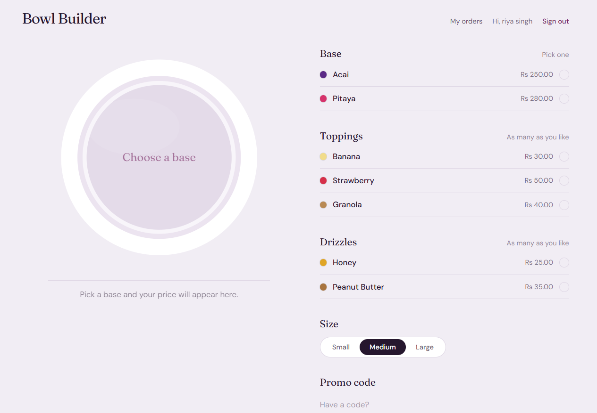

## What it does

- **Bowl builder:** pick a base, toppings, drizzles and a size. The bowl is drawn live as an SVG, and the price and nutrition come from the server on every change.
- **Pricing engine:** pricing is a list of rules (Strategy pattern). A new rule, such as a promo code, is one new class and no changes elsewhere.
- **Accounts and roles:** JWT authentication with CUSTOMER, STAFF and ADMIN roles, enforced on the server.
- **Orders:** each order stores a snapshot of ingredient names, prices and nutrition, so later price changes never rewrite history.
- **Order state machine:** PLACED, PREPARING, READY, PICKED_UP, plus CANCELLED. Invalid jumps are rejected with 409, and customers can cancel only while an order is still PLACED.
- **Inventory:** stock is deducted when an order is placed and restored on cancel, inside one transaction.
- **Live kitchen board:** orders appear and move between columns over WebSockets (STOMP), with no refreshing. Customers see their own order status change live.
- **Favorites, reorder, profile settings and an admin page** for stock and ingredients.

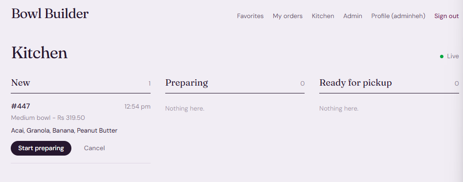
## Screenshots

<table>
<tr>
<td width="50%"><b>Before applying a promo code</b><br>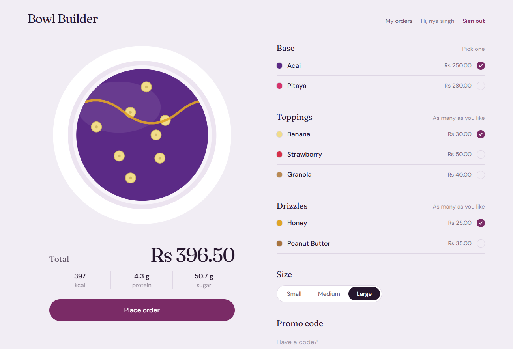</td>
<td width="50%"><b>With a promo code applied</b><br>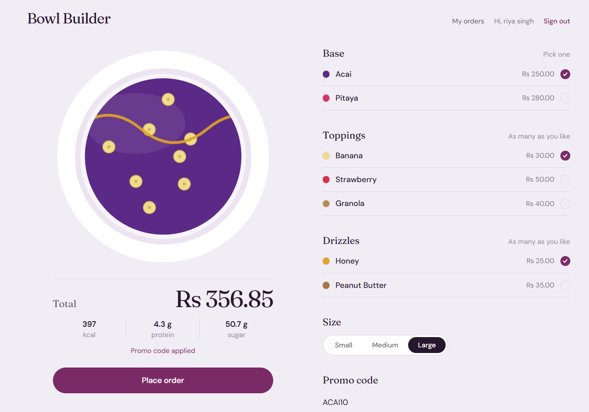</td>
</tr>
<tr>
<td width="50%"><b>Sold-out ingredients are disabled</b><br>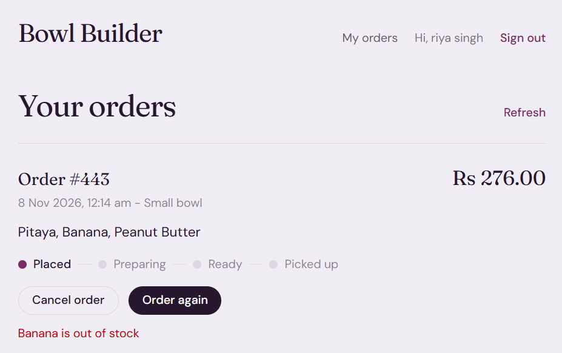</td>
<td width="50%"><b>An order moving through its stages</b><br>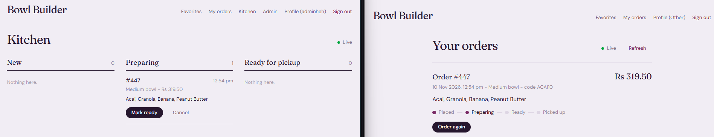</td>
</tr>
<tr>
<td width="50%"><b>Order history</b><br>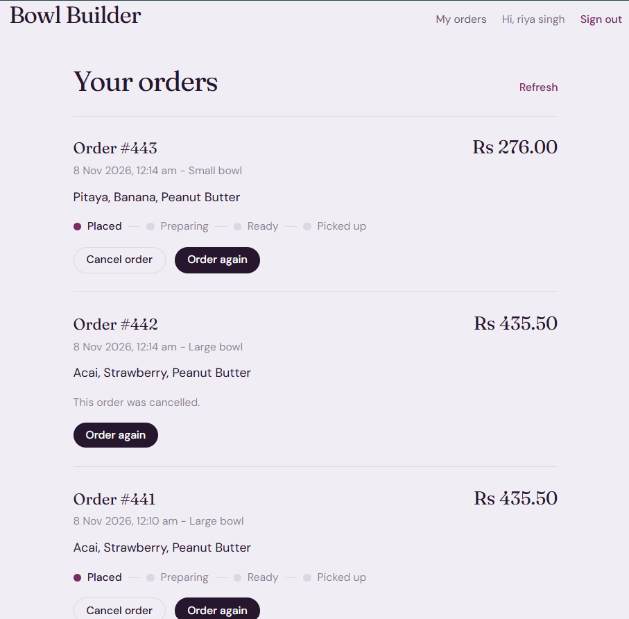</td>
<td width="50%"><b>Cancel is blocked once preparing starts</b><br>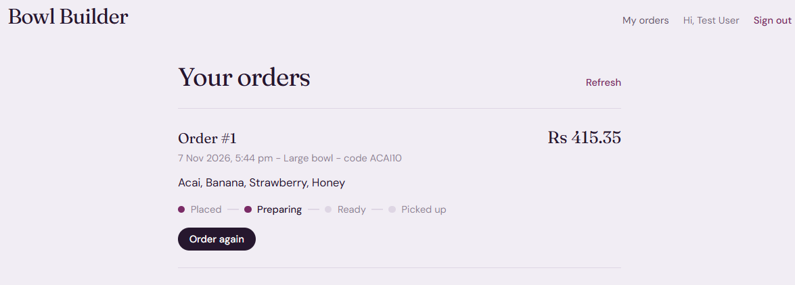</td>
</tr>
<tr>
<td width="50%"><b>Saved favorites</b><br>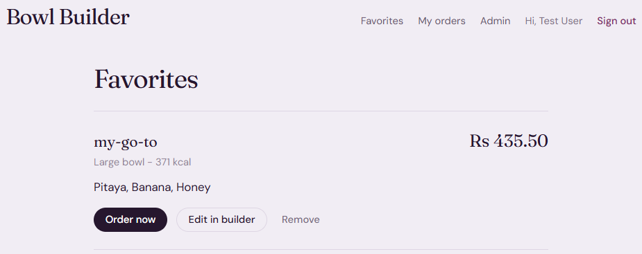</td>
<td width="50%"><b>Profile settings</b><br>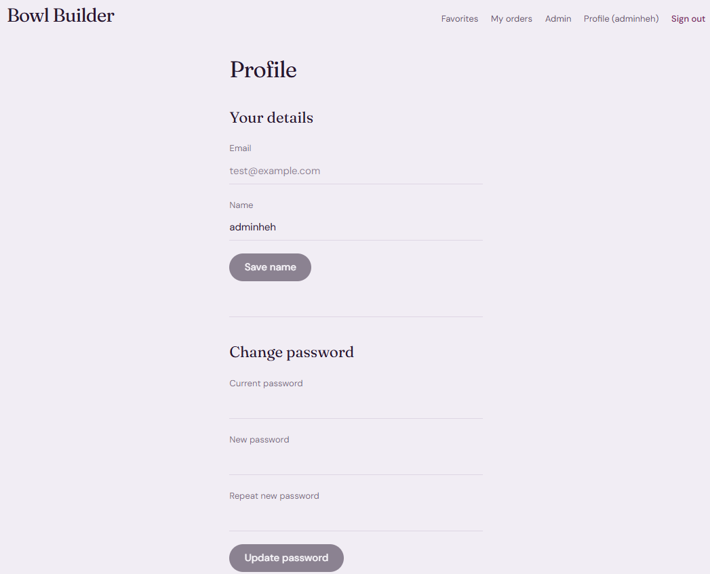</td>
</tr>
<tr>
<td width="50%"><b>Admin: restock ingredients</b><br>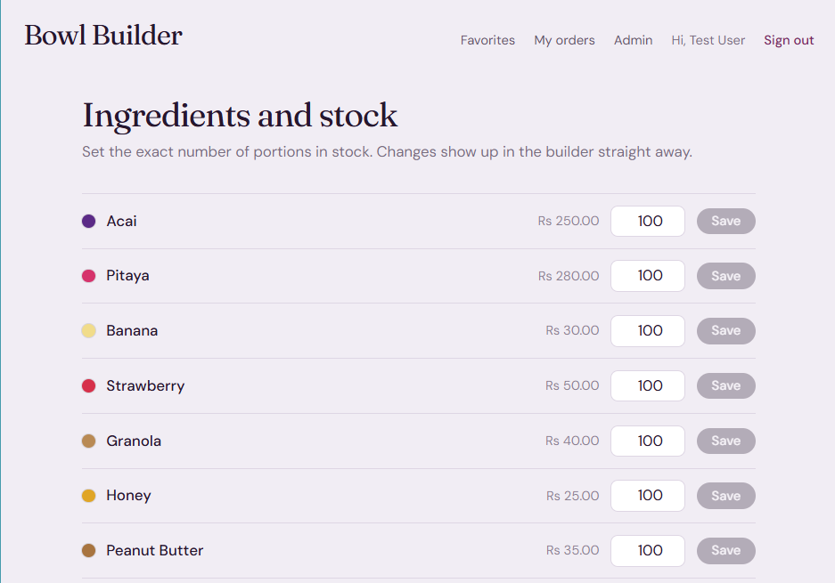</td>
<td width="50%"><b>Admin: add an ingredient</b><br>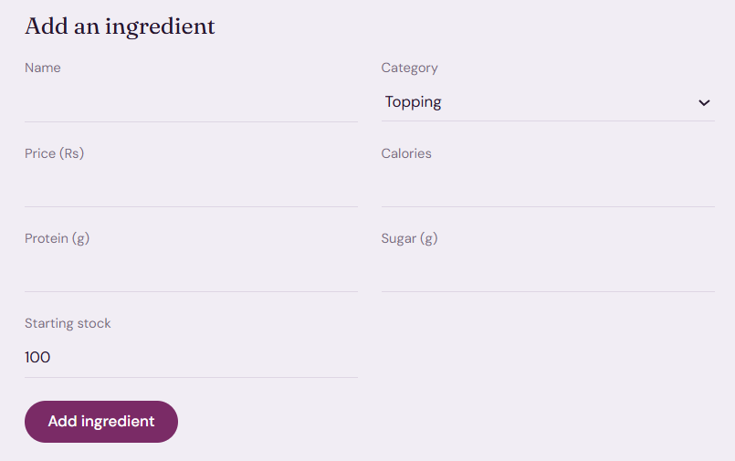</td>
</tr>
<tr>
<td width="50%"><b>Sign in</b><br>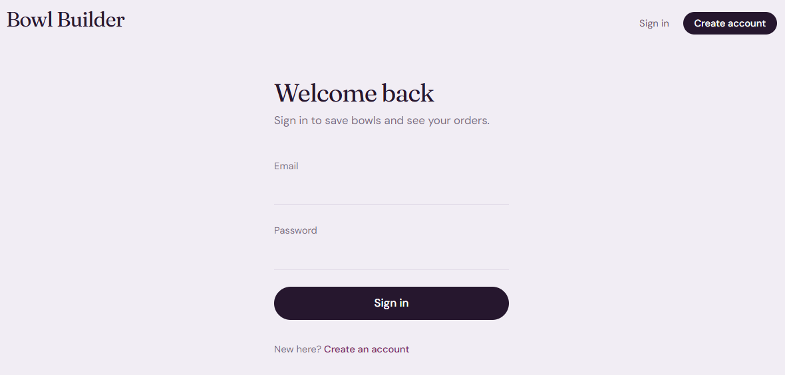</td>
<td width="50%"><b>Create account</b><br>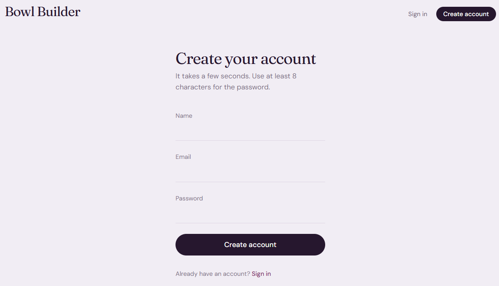</td>
</tr>
</table>

## Architecture

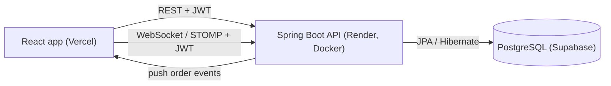

| Layer | Technology |
|---|---|
| Frontend | React, Vite, Tailwind CSS, React Router |
| Backend | Java 21, Spring Boot, Spring Security, Spring Data JPA, WebSocket (STOMP) |
| Database | PostgreSQL on Supabase, row level security on every table |
| Auth | JWT, BCrypt password hashing |
| Testing and CI | JUnit 5, Mockito, AssertJ, GitHub Actions |
| Deployment | Docker, Render (API), Vercel (frontend) |

## Concurrency: preventing overselling

Placing an order deducts one portion of every ingredient in a single transaction. Without protection, simultaneous orders read the same stock and overwrite each other.

| 50 concurrent orders, 10 portions in stock | Accepted | Stock recorded |
|--------------------------------------------|----------|----------------|
| Before (no locking)                        | 32       | 9              |
| After (optimistic locking + retry)         | 10       | 0              |

**How it works**
- `Ingredient` has a `@Version` column, so every update is `... WHERE id = ? AND version = ?`.
- A losing request hits a version conflict, and `OrderPlacementService` retries it in a fresh transaction.
- The retry re-reads current stock and either succeeds or gets a clean `409 Out of stock`.
- Retries live outside the transaction, because a conflict is only detected at commit time.
- `open-in-view` is disabled. With it on, retries reused one stale Hibernate session and some requests failed with 500.

**Reproduce:** start the app, then run `backend/bowl-builder/scripts/concurrency-test.ps1`.

## Other design decisions

- **Realtime security:** browsers cannot set headers on a WebSocket handshake, so the JWT is sent in the STOMP CONNECT frame. Clients are listen-only. Only staff can subscribe to the kitchen feed, and customers receive only their own orders on a per-user queue.
- **Events after commit:** order events are published after the database transaction commits, and a failed push never fails the order itself.
- **Ownership in the query:** looking up an order or favorite uses `findByIdAndUserId`, so someone else's record is a 404, not a 403. Nobody can probe which ids exist.
- **Server-side rules:** the frontend never calculates prices. Hiding the admin or kitchen pages is a convenience, and the API enforces roles regardless.
- **Same error for a bad email and a bad password** at login, so the endpoint cannot be used to find registered emails.

## API overview

| Method and path | Who | What |
|---|---|---|
| `POST /api/auth/register`, `/login` | public | create an account, get a JWT |
| `GET /api/ingredients` | public | list ingredients and stock |
| `POST /api/bowls/price` | public | price and nutrition for a bowl |
| `POST /api/orders`, `GET /api/orders` | signed in | place an order, order history |
| `POST /api/orders/{id}/cancel`, `/reorder` | owner | cancel while PLACED, order again |
| `PATCH /api/orders/{id}/status` | staff, admin | move an order forward |
| `GET /api/staff/orders` | staff, admin | the kitchen queue |
| `/api/favorites` | signed in | save, list, delete favorite bowls |
| `PATCH /api/users/me`, `POST /api/users/me/password` | signed in | profile |
| `POST /api/ingredients`, `PATCH /api/ingredients/{id}/stock` | admin | manage ingredients and stock |

## Run it locally

You need Java 21, Node 20 or newer, and a PostgreSQL database (a free Supabase project works).

**Backend**

```bash
cd backend/bowl-builder
cp config/application.example.properties config/application.properties   # Windows: Copy-Item
# edit config/application.properties with your database details and a JWT secret
./mvnw spring-boot:run                                                    # Windows: .\mvnw spring-boot:run
```

**Frontend** (second terminal)

```bash
cd frontend
npm install
npm run dev
```

The frontend runs on http://localhost:5173 and the API on http://localhost:8080. Run the tests with `./mvnw test`.

**With Docker:** copy `.env.example` to `.env`, fill it in, and run `docker compose up --build`.

## Tradeoffs and what I would do next

- Orders and stock use optimistic locking. If contention on a single hot ingredient grew very large, a conditional `UPDATE ... SET stock = stock - 1 WHERE stock > 0` would avoid retries.
- The JWT lives in `localStorage`. That is simple, but an XSS bug could read it. An HttpOnly cookie would be safer.
- Tokens are not revoked when a password changes. They expire after an hour.
- The WebSocket broker is in memory, so it works for one server instance. Scaling out would need a broker such as RabbitMQ.
- Schema changes use Hibernate `ddl-auto=update`. A migration tool like Flyway would be the next step.
- Tests are unit tests for the pricing rules and the state machine. Integration tests against a throwaway database are the next addition.